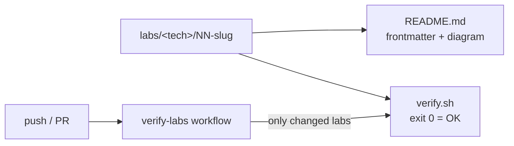

# engineering-lab

[](https://github.com/adrianpabon/engineering-lab/actions/workflows/verify-labs.yml)
[](LICENSE)

Hands-on engineering and architecture lab by **[Adrián Pabón Mendoza](https://www.adrianpabonmendoza.com/)**, Senior Data & AI Engineer and AWS Certified Solutions Architect – Associate.

Every lab here is **self-verifying**: it ships a `verify.sh` that CI runs on each change, so what you read is what actually works.

## What's inside

| Folder | Purpose |
|---|---|
| [`labs/`](labs/) | Atomic labs (1–3 h, one concept each) with an architecture diagram and a `verify.sh` |
| [`projects/`](projects/) | Integrating projects that combine several technologies |
| [`architecture/`](architecture/) | Architecture Decision Records (ADRs) and written designs |
| [`cheatsheets/`](cheatsheets/) | Condensed notes per technology |
| [`journal/`](journal/) | Short session log, one file per day |
| [`templates/`](templates/) | Lab and ADR templates |
| [`scripts/`](scripts/) | Repo utilities |

Tracks: **Docker · Kubernetes · Terraform · AWS · AI**

## Labs

| # | Lab | Tech | Level | Status |
|---|---|---|---|---|
| 01 | [Dockerfile basics](labs/docker/01-dockerfile-basics/) | Docker | beginner | ✅ done |

## How it works



Run any lab locally:

```bash
cd labs/docker/01-dockerfile-basics
./verify.sh
```

Design rationale: [ADR-0001 — Repository structure and self-verifying labs](architecture/adr/0001-repository-structure.md).

## Roadmap

- More Docker labs: multi-stage + non-root images, Compose with Postgres and volumes, debugging.
- **Job Radar**: event-driven job search on AWS (EventBridge Scheduler → Lambda → DynamoDB → SES), provisioned with Terraform.
- Progress tracking generated from lab frontmatter and git history.
- Integration with [adrianpabonmendoza.com](https://www.adrianpabonmendoza.com/).

## Contact

[Website](https://www.adrianpabonmendoza.com/) · [LinkedIn](https://www.linkedin.com/in/adrianpabonmendoza) · [GitHub](https://github.com/adrianpabon)
