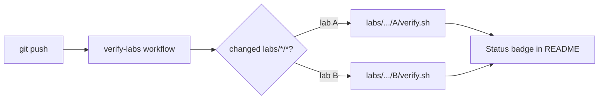

# ADR-0001: Repository structure and self-verifying labs

- **Status:** accepted
- **Date:** 2026-11-11
- **Context area:** repo

## Context

This repository has three goals: keep hands-on practice with technologies I don't use daily, act as a verifiable portfolio for recruiters, and track what I learn over time. A collection of notes or screenshots proves nothing; reviewers need to see that each piece actually works.

## Options considered

1. **One repo per technology** — clean separation, but scattered history and no single place to show progress.
2. **Single monorepo with free-form folders** — easy to start, but inconsistent and hard to verify automatically.
3. **Single monorepo with atomic labs + a verification contract** — every lab has the same shape and a `verify.sh` that CI can run.

## Decision

Option 3. Each lab lives in `labs/<tech>/NN-slug/`, covers one concept (1–3 h), and ships:

- a `README.md` with mandatory frontmatter (status, dates, time spent) and an architecture diagram,
- a `verify.sh` that is idempotent, cleans up after itself and exits `0` on success.

A **single** GitHub Actions workflow detects changed labs and runs only their `verify.sh` — no per-lab workflows.

## Consequences

- **Easier:** adding a lab is copy-template + code + `verify.sh`; CI scales without new YAML; frontmatter enables a future progress dashboard.
- **Harder:** every lab must be runnable inside a GitHub-hosted runner (labs needing cloud credentials will need a separate, manually triggered path).
- **Accepted trade-off:** some upfront discipline per lab in exchange for verifiable proof.
