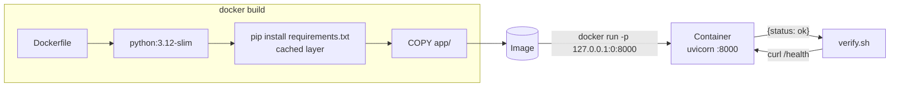

# Dockerfile basics

## Goal

Package a minimal FastAPI service into a container image and prove it serves `GET /health` correctly.

## Architecture



## What I built

- `app/main.py` — FastAPI app with a single `GET /health` endpoint.
- `Dockerfile` — single-stage image on `python:3.12-slim`; dependencies copied before code to reuse the layer cache; exec-form `CMD` so uvicorn is PID 1 and handles `SIGTERM`.
- `verify.sh` — builds the image, runs it on a random free port, polls `/health`, and removes container + image on exit.

## How to verify

```bash
./verify.sh   # exit 0 = OK; cleans up everything it creates
```

## What broke and how I fixed it

- TODO

## What I learned

- TODO

## Interview questions this answers

- TODO
