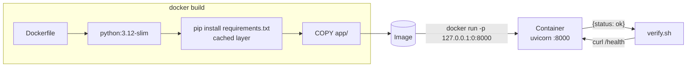

# Dockerfile basics

## Goal

Package a minimal FastAPI service into a container image and prove it serves `GET /health` correctly.

## Architecture



## What I built

- `app/main.py` — FastAPI app with a single `GET /health` endpoint.
- `Dockerfile` — single-stage image on `python:3.12-slim`; dependencies copied before code to reuse the layer cache; exec-form `CMD` so uvicorn is PID 1 and handles `SIGTERM`.
- `verify.sh` — builds the image, runs it on a random free port, polls `/health`, and removes container + image on exit.

## How to verify

```bash
./verify.sh   # exit 0 = OK; cleans up everything it creates
```

## What broke and how I fixed it

- **`docker run --name t` was rejected** — `Invalid container name (t), only [a-zA-Z0-9][a-zA-Z0-9_.-] are allowed`. Container names need at least 2 characters. Fixed by using a descriptive name (`hola-lab`).
- **`docker images python:3.12-slim` returned nothing** even though the image was built on top of it. BuildKit pulled the base layers but didn't keep the base as a separately tagged image; its layers only exist inside `lab01`. Used `docker history lab01` to inspect them instead.
- **Shell-form `CMD` took ~10 s to stop** (see experiment below). Kept exec form in the `Dockerfile`.

## What I learned

**1. Layer cache depends on instruction order.** After changing only `app/main.py` and rebuilding, `docker history` showed `COPY app/` created *3 minutes ago* while `pip install` and `COPY requirements.txt` were still from *26 minutes ago* — reused from cache. Copy rarely-changing files (dependencies) before frequently-changing ones (code).

**2. Where the image size actually comes from** (`docker history lab01`, arm64):

| Layer | Size |
|---|---|
| Debian trixie base | 110 MB |
| Python 3.12 install | 44.7 MB |
| apt dependencies | 4.97 MB |
| **Base image subtotal** | **≈ 160 MB (~90 %)** |
| `pip install` (FastAPI + uvicorn) | 16.8 MB |
| App code + requirements | ≈ 0.03 MB |
| **Total unpacked layers** | **≈ 176.5 MB** |

`docker images` reported `DISK USAGE 225MB` and `CONTENT SIZE 48.7MB`: 176.5 MB unpacked + 48.7 MB compressed blobs ≈ 225 MB — Docker Desktop's containerd image store keeps both. Image size depends on *where* you measure it.

Takeaway: for this app a multi-stage build would save little, because the weight is the runtime base, not build tooling. Shrinking it means changing the base image (e.g. distroless/alpine) — explored in lab 02.

**3. Exec form vs shell form `CMD` (PID 1 and signals).**

| Form | PID 1 | `time docker stop` |
|---|---|---|
| Exec: `CMD ["uvicorn", ...]` | uvicorn | **0.46 s** |
| Shell: `sh -c "uvicorn ..."` | `sh` | **10.16 s** |

`docker stop` sends `SIGTERM` to PID 1. In exec form uvicorn receives it and shuts down gracefully. In shell form `sh` doesn't forward the signal, so Docker waits the 10 s grace period and sends `SIGKILL` — in-flight requests are cut, cleanup doesn't run, and rollouts get slower (Kubernetes waits 30 s per pod by default).

## Interview questions this answers

- *Why does the order of instructions in a Dockerfile matter?* — Layer caching: each instruction is a layer, and a change invalidates every layer after it.
- *Why is my image so large, and how would you shrink it?* — Measure with `docker history`; here ~90 % is the base image, so pick a smaller base. Multi-stage removes build-time dependencies, not the runtime.
- *What's the difference between `docker images` disk usage and content size?* — Unpacked layers plus compressed blobs vs. the compressed download size.
- *Exec form vs shell form `CMD`?* — Exec form makes your app PID 1 so it receives `SIGTERM`; shell form makes `sh` PID 1, which swallows the signal and leads to `SIGKILL` after the grace period.
- *What do `-d` and `--name` do in `docker run`?* — Run detached in the background; give the container a stable name (min. 2 characters) to reference it.
