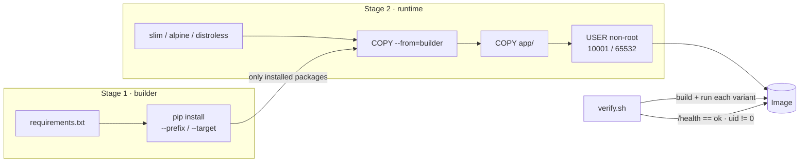

# Multi-stage, non-root and base images

## Goal

Rebuild the lab 01 FastAPI service with a multi-stage build and a non-root user on three base images (Debian slim, Alpine, distroless), then measure size and security trade-offs against the lab 01 baseline.

## Architecture



## What I built

Three Dockerfiles for the same app (Python 3.13 everywhere for a fair comparison):

| File | Runtime base | Non-root user |
|---|---|---|
| `Dockerfile.slim` | `python:3.13-slim` | `useradd` UID 10001 |
| `Dockerfile.alpine` | `python:3.13-alpine` | `adduser` (BusyBox) UID 10001 |
| `Dockerfile.distroless` | `gcr.io/distroless/python3-debian13:nonroot` | built-in `nonroot` UID 65532 |

`verify.sh` builds and runs every variant, checks `/health`, fails if the container process runs as UID 0 (via `docker top`), prints the compressed size, and cleans up.

## Results

| Variant | Unpacked layers | Compressed (download) | Runtime UID | Shell inside |
|---|---|---|---|---|
| Lab 01 baseline (slim, single-stage) | 176.5 MB | 48.7 MB | **0 (root)** | yes |
| slim, multi-stage | 175.6 MB | 48.5 MB | 10001 | yes |
| **alpine**, multi-stage | **74.4 MB** | **22.7 MB** | 10001 | yes |
| **distroless** | 97.7 MB | 27.8 MB | 65532 | **no** |

## How to verify

```bash
./verify.sh   # exit 0 = all variants healthy and non-root; cleans up everything
```

## What broke and how I fixed it

- **Wrong prediction: I expected slim multi-stage to be the smallest.** It was the same size as lab 01 (175.6 vs 176.5 MB). Multi-stage only drops build-time leftovers; this app has none worth mentioning, and ~90 % of the weight is the base image (see lab 01).
- **`docker top <c> -o uid` failed** with `Couldn't find PID field in ps output` — Docker needs the `pid` column to map processes. Fixed with `docker top <c> -o pid,uid`.
- **Distroless has no Python matching `python:3.12`.** `distroless/python3-debian13` ships Python 3.13 (debian12 ships 3.11), and the builder's Python minor version must match the runtime or installed packages won't load. Standardized every variant on 3.13.
- **Distroless has no shell**, so `useradd` and shell-form commands are impossible; used the `:nonroot` tag and exec-form `CMD` with the image's `python3` entrypoint (`CMD ["-m", "uvicorn", ...]`).

## What I learned

- **Multi-stage ≠ smaller by default.** It removes build tooling; it doesn't shrink the runtime base. For Python apps without compiled deps the gain is near zero — change the base instead.
- **Alpine is the smallest (-58 % vs lab 01)** but uses musl libc instead of glibc: some Python wheels (numpy, pandas, pydantic-core…) may be missing or behave differently, and builds can get slow.
- **Distroless is the most secure**: no shell, no package manager, no `pip`. `docker exec <c> sh` fails with `exec: "sh": executable file not found` — an attacker who gets in has nothing to work with, and image scanners report fewer CVEs. Trade-off: harder debugging (use the `:debug` tag, `docker debug`, or Kubernetes ephemeral containers).
- **Non-root is one line (`USER`) and verifiable from the host**: `docker top` shows the real UID of the container process. Fixed numeric UIDs (10001) map cleanly to Kubernetes `runAsUser` / `runAsNonRoot`.

## Interview questions this answers

- *What is a multi-stage build and when does it actually reduce image size?* — Multiple `FROM`s; copy only artifacts into the final stage. Big win for compiled languages (Java, Go) or native deps; small for pure-Python apps.
- *Alpine vs distroless vs slim?* — Alpine minimizes size (musl caveats); distroless minimizes attack surface with glibc compatibility; slim is the most compatible and debuggable.
- *Why shouldn't containers run as root, and how do you enforce it?* — Limits blast radius of a container escape or RCE. `USER <uid>` in the Dockerfile, verify with `docker top`, enforce with `runAsNonRoot` in Kubernetes.
- *How do you debug a distroless container with no shell?* — `:debug` image variant, `docker debug`, or `kubectl debug` with an ephemeral container.
