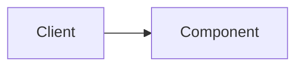

---
title:
tech:            # docker | kubernetes | terraform | aws | ai
tags: []
level:           # beginner | intermediate | advanced
status:          # in-progress | done | to-review
date:            # YYYY-MM-DD
last_reviewed:   # YYYY-MM-DD
time_spent_h:
---

# <Lab title>

## Goal

<!-- One concept, one sentence. What should this lab prove? -->

## Architecture

<!-- Mermaid diagram of the components and how they interact. Renders natively on GitHub. -->



## What I built

<!-- Short description of the moving parts and key design choices. -->

## How to verify

```bash
./verify.sh   # exit 0 = OK; cleans up everything it creates
```

## What broke and how I fixed it

-

## What I learned

-

## Interview questions this answers

-
